<h2>TensorFlow-FlexUNet-Image-Segmentation-Pneumonia-Chest-X-Ray (2026/11/12)</h2>
<h3>Pneumonia-Chest-X-Ray : AI Generated Pseudo Masks Segmentation Challenge</h3>
Sarah T. Arai 
Software Laboratory antillia.com  
This is the first experiment of Image Segmentation for <b>Pneumonia-Chest-X-Ray </b>
 based on
our <a href="https://github.com/sarah-antillia/TensorFlow-FlexUNet-Image-Segmentation-Model">TensorFlowFlexUNet Model</a>
 (<b>TensorFlow Flexible UNet Image Segmentation Model for Multiclass</b>) and a 512x512-pixel PNG
<a href="https://drive.google.com/file/d/1jYRVrlvk5r3l4yiGQbz-NW2JPy8XB6cJ/view?usp=sharing"><b>Pneumonia-Chest-X-Ray-ImageMask-Datasaet.zip</b></a>
with colored masks (<a href="https://www.apache.org/licenses/LICENSE-2.0">Apache 2.0</a>
) derived  by us from the Kaggle
  
<a href="https://www.kaggle.com/datasets/woleolajide86/pneumonia-chest-xrays">
<b>Pneumonia-Chest X-Ray
</b>
</a> by Wole Olajide.
  

<b>Actual Image Segmentation for Pneumonia-Chest-X-Ray Images of 512x512 pixels</b> 
As shown below, the inferred masks resemble the ground-truth masks except for the second case.  
 
<b>class_color_map = {Lung: cyan, Pneumonia: magenta, Tuberculosis: yellow}</b>
 
 
<table>
<tr>
<th width="320" height="auto">Input: image</th>
<th width="320" height="auto">Mask (ground_truth)</th>
<th width="320" height="auto">Prediction: inferred_mask</th>
</tr>
<tr>
<td>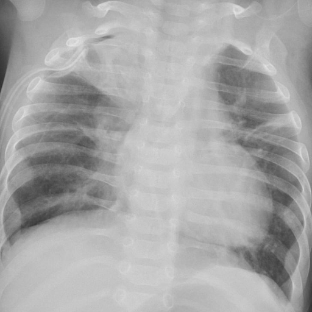</td>
<td>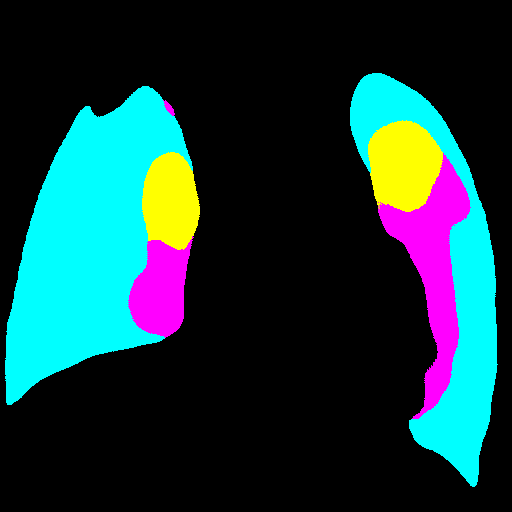</td>
<td>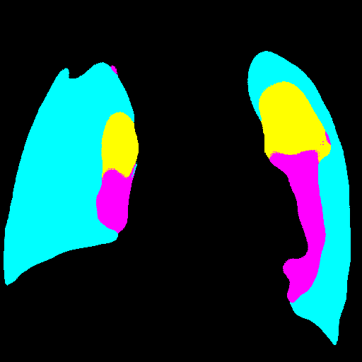</td>
</tr>
<tr>
<td>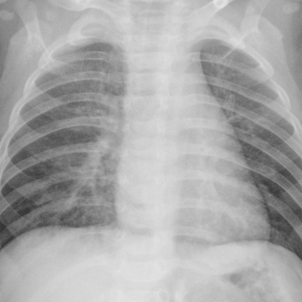</td>
<td>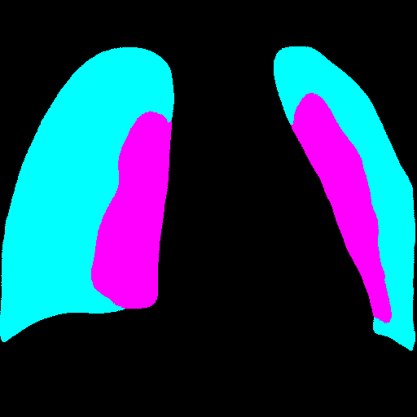</td>
<td>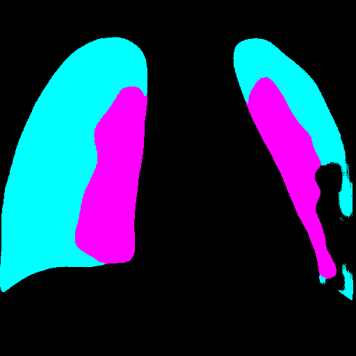</td>
</tr>
<tr>
<td>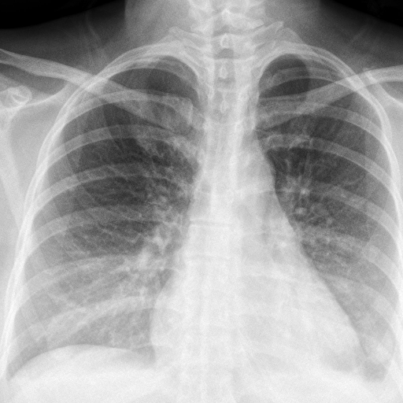</td>
<td>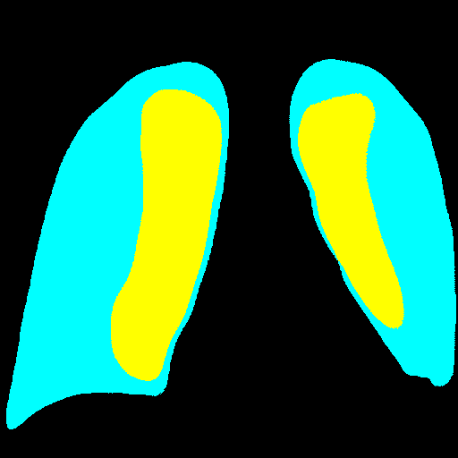</td>
<td>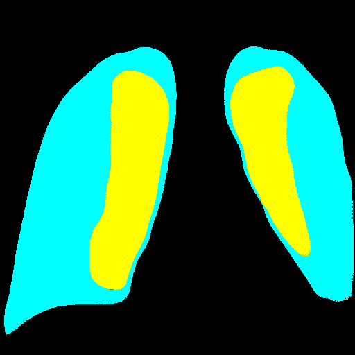</td>
</tr>
</table>

 
<h3>1. Dataset Citation</h3>
The dataset used here was derived from the following Kaggle:  
<a href="https://www.kaggle.com/datasets/woleolajide86/pneumonia-chest-xrays">
<b>Pneumonia-Chest X-Ray
</b>
</a>  
<b>Chest X-Ray Dataset containing Normal and Pneumonia X-rays</b>
  by Wole Olajide.
</a> 
  
The following explanation (excerpt) was taken the website above.
  
<b>About Dataset</b> 
The Pneumonia_Chest_Xrays dataset is a curated collection of anterior-posterior (AP) chest X-ray images used for automated pneumonia classification. The dataset is derived from open-access medical imaging repositories and contains radiographic images labelled by qualified medical professionals, indicating the presence or absence of pneumonia.
  
This dataset consists of two primary classes:
  
Normal: Chest X-rays showing no signs of pneumonia or other pathological conditions.
  
Pneumonia: Chest X-rays exhibiting radiological evidence of pneumonia, including bacterial and viral infections.
  
The dataset exhibits a noticeable class imbalance, with pneumonia-positive cases outnumbering the normal cases (or vice versa depending on the version), which can significantly affect the performance of traditional classification models.
  
Image Characteristics
Modality: X-ray (radiograph)
  
Projection: Anterior-Posterior (AP)
  
Format: JPEG/PNG
  
Image Size: Varies (resized to 224×224 for model input)
  
Color Mode: Grayscale
  
Source and Annotation
The images are sourced from publicly available medical datasets such as:
  
NIH ChestX-ray14
  
RSNA Pneumonia Detection Challenge
  
Kermany et al. Pneumonia Dataset (originally hosted on Kaggle)
  
Each image is labeled based on diagnostic reports by certified radiologists. No personally identifiable information (PII) is included, and the dataset complies with ethical standards for medical data use.
  
<b>License</b> 
<a href="https://www.apache.org/licenses/LICENSE-2.0">Apache 2.0</a>
 
 
<h3>
2. Pneumonia-Chest-X-Ray ImageMask Dataset
</h3>
<h3>2.1 Download ImageMask Dataset</h3>
 If you would like to train this Pneumonia-Chest-X-Ray Segmentation model,
 please download the dataset from the Google Drive 
<a href="https://drive.google.com/file/d/1jYRVrlvk5r3l4yiGQbz-NW2JPy8XB6cJ/view?usp=sharing">
<b>Pneumonia-Chest X-Ray-ImageMask-Dataset.zip</b>
</a> 
and put it under the <b>./dataset</b> folder.
 
<pre>
./dataset
└─Pneumonia-Chest-X-Ray
    ├─test
    │   ├─images
    │   └─masks
    ├─train
    │   ├─images
    │   └─masks
    └─valid
         ├─images
         └─masks
</pre>
 
<b>Pneumonia-Chest-X-Ray Statistics</b> 
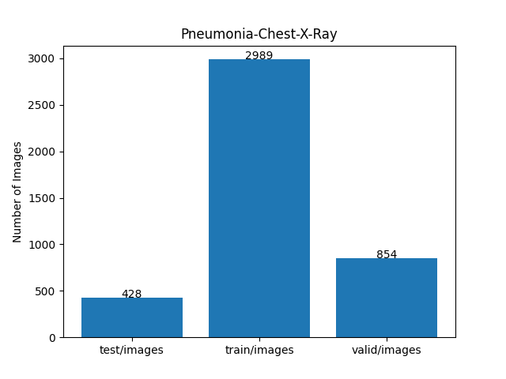 
 
As shown above, the number of images in the training and valid datasets is large enough to use for the
 training set of our segmentation model.
 
<h3>2.2 Derivation of ImageMask Dataset</h3>
The folder structure of the original dataset  is as follows, but it contains no annotation (mask) files.
The <b>PNEUMONIA</b> folder contains  X-ray JPEG files of pneumonia caused by bacteria and viruses.
<pre>
./Pneumonia_Chest_Xray
    ├─NORMAL
    │   ├─IM-0001-0001.jpeg
...
    │   └─NORMAL2-IM-1442-0001.jpeg
    └─PNEUMONIA
         ├─person1_bacteria_1.jpeg
...
         └─person1954_bacteria_4886.jpeg
</pre>
<b>Step 1</b> 
We generated a 512x512-pixel PNG master images from the JPEG image files in <b>PNEUMONIA
</b> subfolder.
  
<b>Step 2</b> 
We generated the first pseudo masks corresponding to the master images
by applying a segmentation (inference) method of the pretrained model 
<a href="https://github.com/sarah-antillia/TensorFlow-FlexUNet-Image-Segmentation-Chest-X-Ray">
TensorFlow-FlexUNet-Image-Segmentation-Chest-X-Ray
</a> to the master images.
  
<b>Step 3</b> 
We generated an ImageMask dataset from all pairs of the first pseudo masks and the master images.
  
<b>Step 4</b> 
We generated a new pretrained FlexUNet segmentation model by using the  ImageMask 
dataset derived at Step 3.
  
<b>Step 5</b> 
We generated the second pseudo masks corresponding to the master images by applying a segmentation method of the new 
pretrained FlexUNet model obtained at Step 4.
  
<b>Step 6</b> 
We finallay generated our own 
<a href="https://drive.google.com/file/d/1jYRVrlvk5r3l4yiGQbz-NW2JPy8XB6cJ/view?usp=sharing">Pneumonia-Chest-X-Ray-ImageMask-Dataset</a> from all pairs of the second pseudo masks and the master images.
  
<h3>2.3 Train Sample Images and Masks</h3>
<b>Train_sample_images</b> 
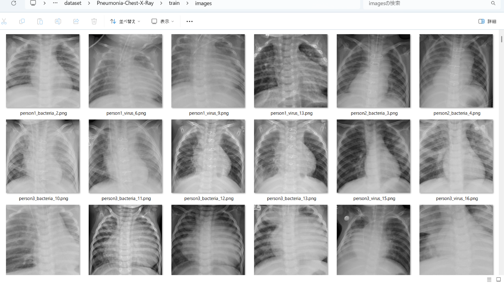
 
<b>Train_sample_masks</b> 
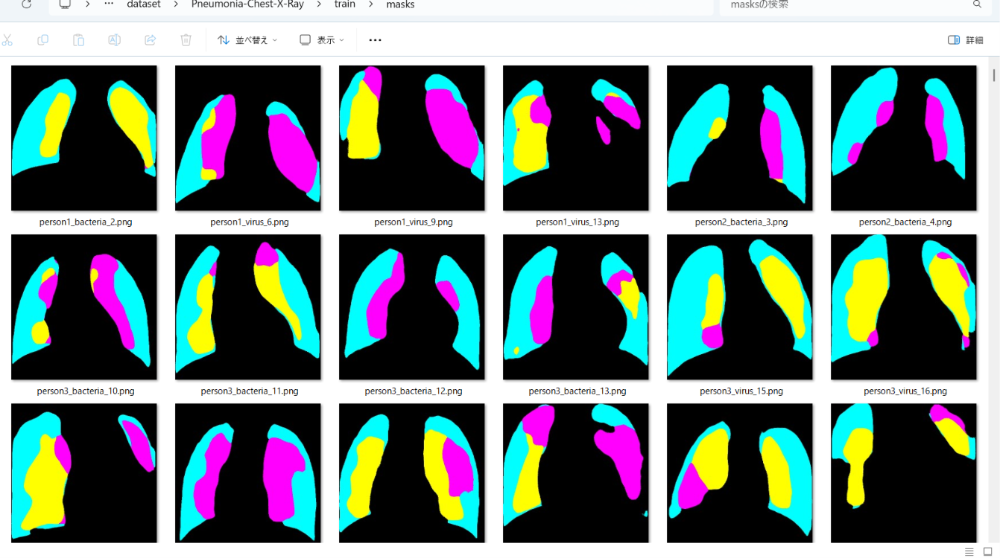
 
<h3>
3. Train TensorFlowFlexUNet Model
</h3>
 We trained the Pneumonia-Chest-X-Ray TensorFlowFlexUNet model using the following
<a href="./projects/TensorFlowFlexUNet/Pneumonia-Chest-X-Ray/train_eval_infer.config"> <b>train_eval_infer.config</b></a> file.  
Please move to ./projects/TensorFlowFlexUNet/Pneumonia-Chest-X-Ray and run the following bat file. 
<pre>
>1.train.bat
</pre>
This runs the following command. 
<pre>
>python ../../../src/TensorFlowFlexUNetTrainer.py ./train_eval_infer.config
</pre>

<b>Model parameters</b> 
Defined a small <b>base_filters=16 </b> and large <b>base_kernels=(11,11)</b> for the first Conv Layer of Encoder Block of 
<a href="./src/TensorFlowFlexUNet.py">TensorFlowFlexUNet.py</a> 
and a large <b>num_layers=8</b> (including a bridge between Encoder and Decoder Blocks).
<pre>
[model]
; You may specify your own UNet class derived from our TensorFlowFlexModel
model         = "TensorFlowFlexUNet"
generator     =  False
image_width    = 512
image_height   = 512
image_channels = 3
num_classes    = 4
base_filters   = 16
base_kernels   = (11,11)
num_layers     = 8
dropout_rate   = 0.05
dilation       = (1,1)
</pre>
<b>Learning rate</b> 
Defined a small learning rate.  
<pre>
[model]
learning_rate  = 0.00007
</pre>
<b>Loss and metrics functions</b> 
Specified "categorical_focal_dice_loss" and <a href="./src/dice_coef_multiclass.py">"dice_coef_hybrid"</a>. 
<pre>
[model]
loss           = "categorical_focal_dice_loss"
metrics        = ["dice_coef_hybrid"]
hybrid_alpha   = 1.6
hybrid_beta    = 0.4
</pre>
<b>Dataset class</b> 
Specified <a href="./src/ImageCategorizedMaskDataset.py">ImageCategorizedMaskDataset</a> class. 
<pre>
[dataset]
class_name    = "ImageCategorizedMaskDataset"
</pre>
 
<b>Learning rate reducer callback</b> 
Enabled the learning_rate_reducer callback and a small reducer_patience.
<pre> 
[train]
learning_rate_reducer = True
reducer_factor     = 0.4
reducer_patience   = 4
</pre>
<b>Early stopping callback</b> 
Enabled early stopping callback with the patience parameter.
<pre>
[train]
patience      = 10
</pre>
<b>RGB Color map</b> 
Specified RGB color map dict for Pneumonia-Chest-X-Ray 2 classes. 
<pre>
[mask]
mask_datatyoe    = "categorized"
mask_file_format = ".png"
;Pneumonia-Chest-X-Ray RGB color map dict for 1+3 classes.
; Background: black,  Lung:cyan,   Pneumonia: magenta,  Tuberculosis: yellow
rgb_map = {(0,0,0):0,(0,255,255):1, (255,0,255):2, (255,255,0):3}
</pre>

<b>Epoch change inference callback</b> 
Enabled <a href="./src/EpochChangeInferencer.py">epoch_change_infer callback</a></b>. 
<pre>
[train]
epoch_change_infer       = True
epoch_change_infer_dir   =  "./epoch_change_infer"
num_infer_images         = 6
</pre>

By using this callback, on every epoch change, the inference procedure can be called
 for 6 images in the <b>mini_test</b> folder. This will help you confirm how the predicted mask changes 
 at each epoch during your training process.  
  
<!--
As shown below, early in the model training, the predicted masks from our FlexUNet segmentation model showed 
discouraging results.
 However, as training progressed through the epochs, the predictions gradually improved. 
   
 
-->
<b>Epoch_change_inference output at starting (epoch 1,2,3)</b> 
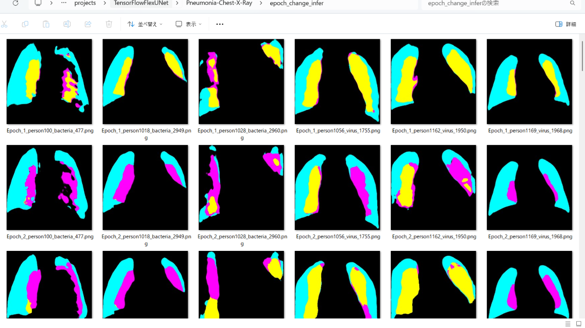 
 
<b>Epoch_change_inference output at middlepoint (epoch 10,11,12)</b> 
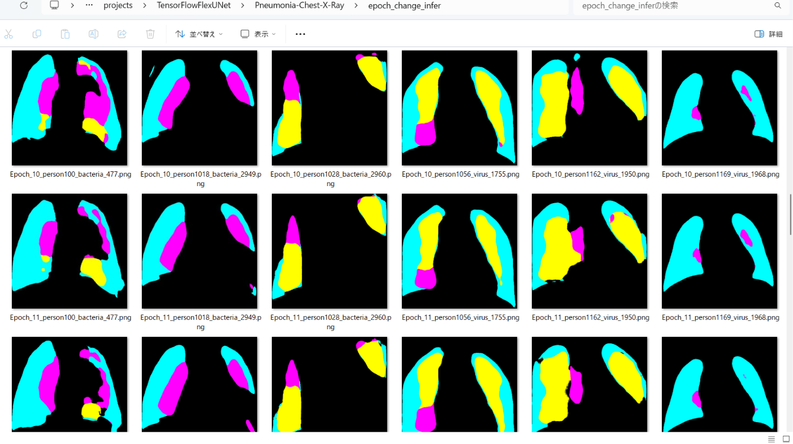 
 
<b>Epoch_change_inference output at ending (epoch 22,23,24)</b> 
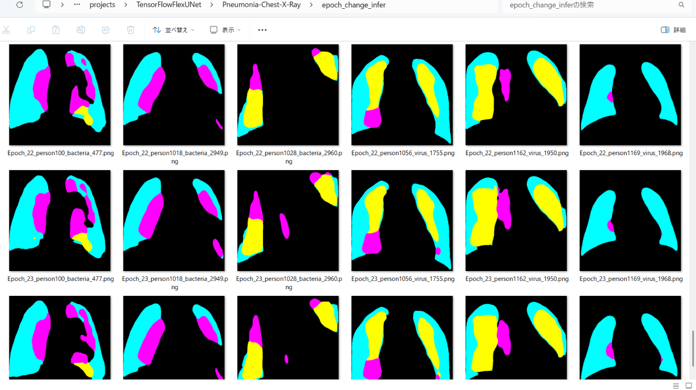 
 
In this experiment, the training process was stopped at epoch 24 by EarlyStoppingCallback. 
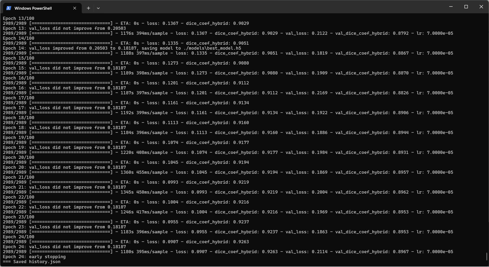 
 
<a href="./projects/TensorFlowFlexUNet/Pneumonia-Chest-X-Ray/eval/train_metrics.csv">train_metrics.csv</a> 
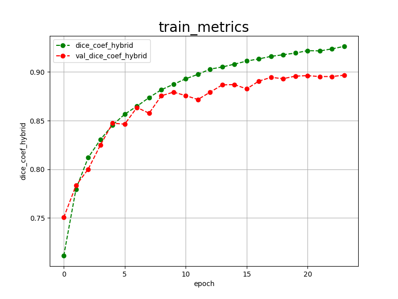 
 
<a href="./projects/TensorFlowFlexUNet/Pneumonia-Chest-X-Ray/eval/train_losses.csv">train_losses.csv</a> 
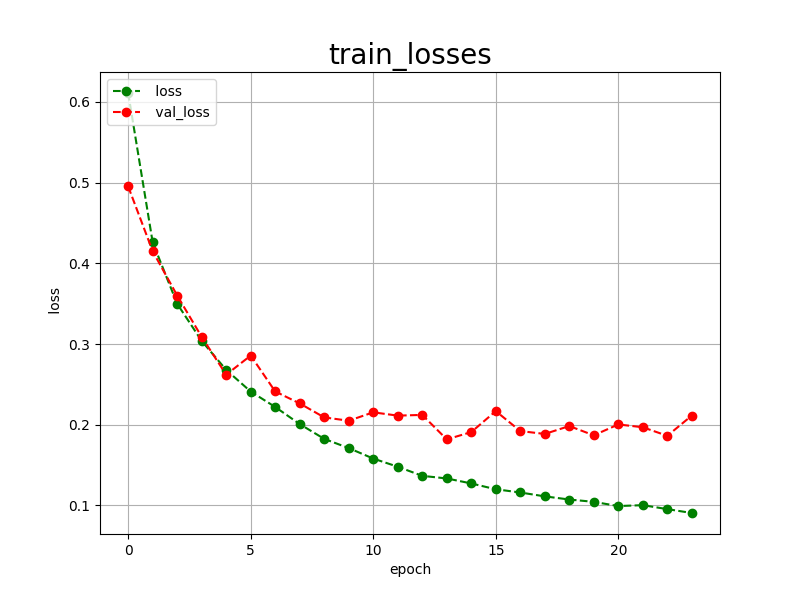 
 
<h3>
4. Evaluation
</h3>
Please move to <b>./projects/TensorFlowFlexUNet/Pneumonia-Chest-X-Ray</b> folder,
and run the following bat file to evaluate the TensorFlowUNet model for Pneumonia-Chest-X-Ray. 
<pre>
>./2.evaluate.bat
</pre>
This runs the following command.
<pre>
>python ../../../src/TensorFlowFlexUNetEvaluator.py ./train_eval_infer.config
</pre>
Evaluation console output: 
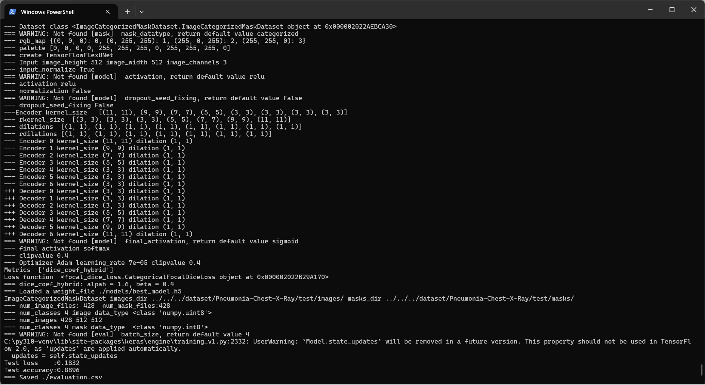
  Image-Segmentation-Pneumonia-Chest-X-Ray

<a href="./projects/TensorFlowFlexUNet/Pneumonia-Chest-X-Ray/evaluation.csv">evaluation.csv</a> 
The loss (categorical_focal_dice_loss) on this Pneumonia-Chest-X-Ray/test was not low, and dice_coef_hybrid was not high,
 as shown below.
 
<pre>
categorical_focal_dice_loss,0.1832
dice_coef_hybrid,0.8896
</pre>
 
<h3>
5. Inference
</h3>
Please move to <b>./projects/TensorFlowFlexUNet/Pneumonia-Chest-X-Ray</b> folder
and run the following bat file to infer segmentation regions for images using the trained TensorFlowUNet model for Pneumonia-Chest-X-Ray. 
<pre>
>./3.infer.bat
</pre>
This runs the following command.
<pre>
>python ../../../src/TensorFlowFlexUNetInferencer.py ./train_eval_infer.config
</pre>

<b>mini_test_images</b> 
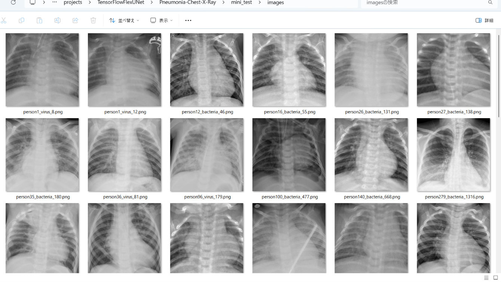 
<b>mini_test_mask(ground_truth)</b> 
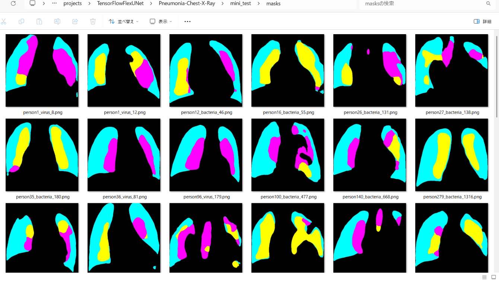 

<b>Inferred test masks</b> 
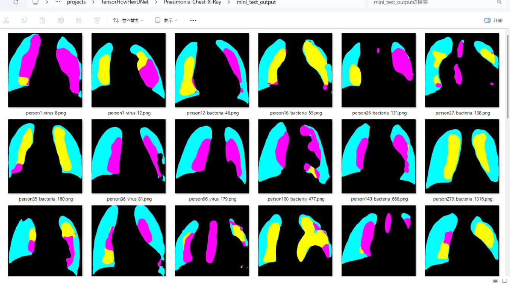 
 

<b>Enlarged images and masks for Pneumonia-Chest-X-Ray Images of 512x512 pixels</b> 
As shown below, the inferred masks look similar to the ground truth masks except for the 
sixth case. 
 
<b>class_color_map = {Lung: cyan, Pneumonia: magenta, Tuberculosis: yellow}</b>
  
<table>
<tr>
<th width="320" height="auto">Image</th>
<th width="320" height="auto">Mask (ground_truth)</th>
<th width="320" height="auto">Inferred-mask</th>
</tr>
<tr>
<td>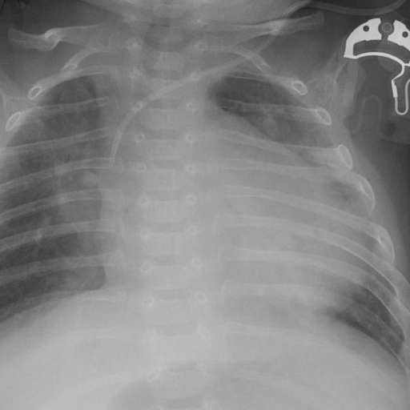</td>
<td>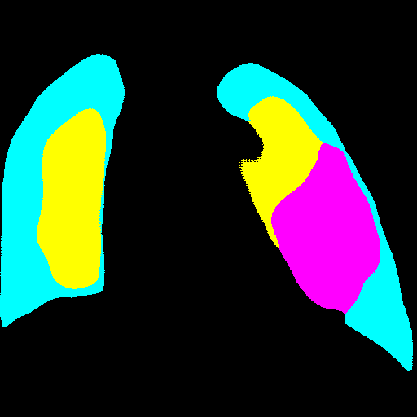</td>
<td>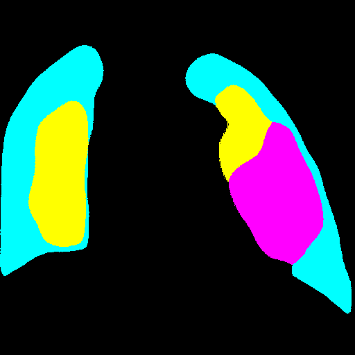</td>
</tr>
<tr>
<td>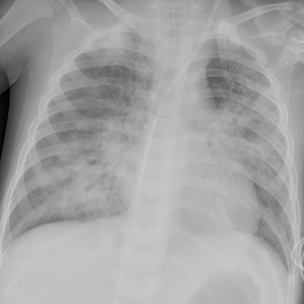</td>
<td>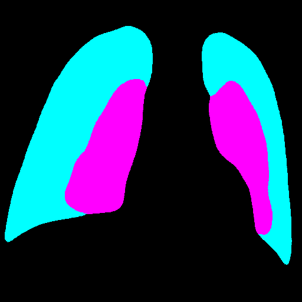</td>
<td>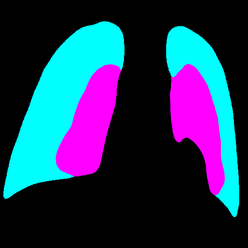</td>
</tr>
<tr>
<td>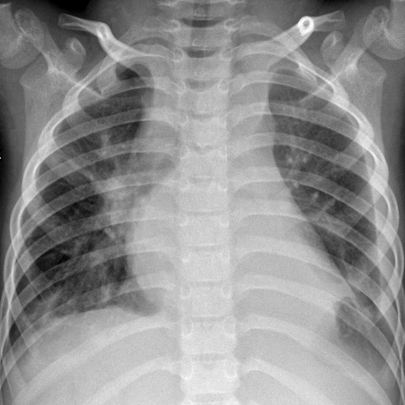</td>
<td>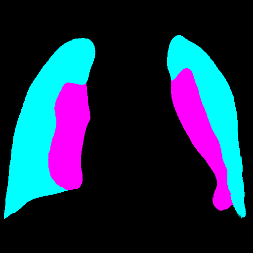</td>
<td>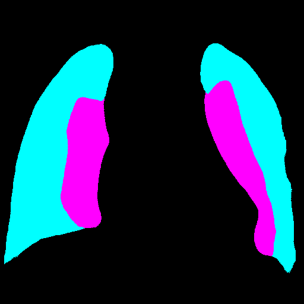</td>
</tr>
<tr>
<td>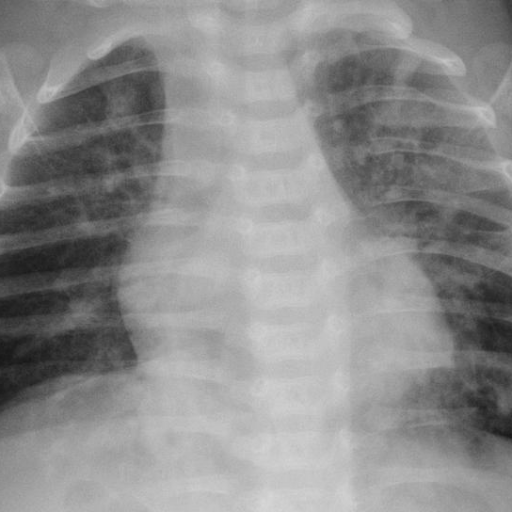</td>
<td>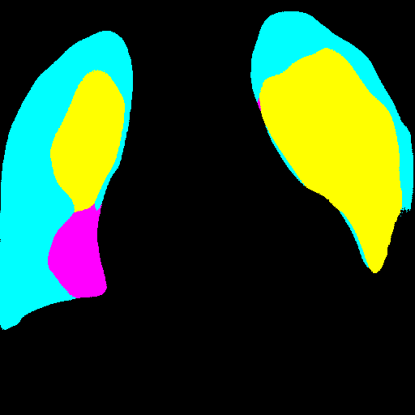</td>
<td>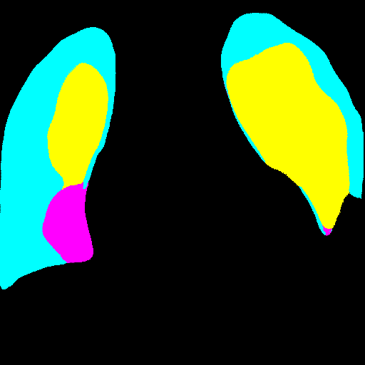</td>
</tr>
<tr>
<td>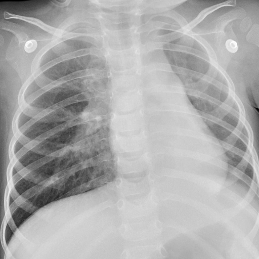</td>
<td>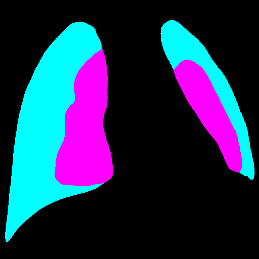</td>
<td></td>
</tr>
<tr>
<td>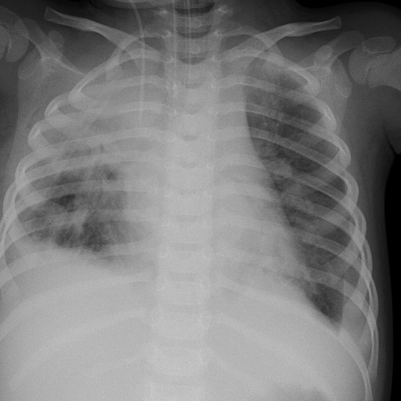</td>
<td>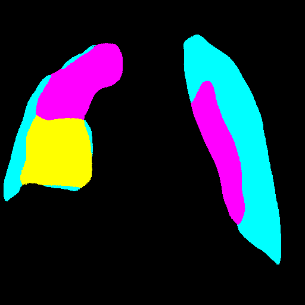</td>
<td>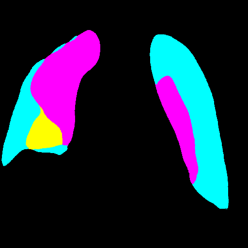</td>
</tr>
</table>

 
<h3>
References
</h3>
<b>1. Efficient and Accurate Pneumonia Detection Using a Novel Multi-Scale Transformer Approach</b> 
Alireza Saber, Pouria Parhami, Alimihammad Siahkarzadeh, Amirreza Fateh 
<a href ="https://arxiv.org/html/2408.04290v1">
https://arxiv.org/html/2408.04290v1
</a>
  
<b>2. Pneumonia detection from enhanced Pneumonia-Chest X-Ray images based on Double SGAN model</b> 
Zhijing Xu & Haoyang Zhang 
<a href="https://www.nature.com/articles/s41598-026-39785-w" >
https://www.nature.com/articles/s41598-026-39785-w
</a>
  
<b>3. Leveraging human expert image annotations to improve pneumonia 
differentiation through human knowledge distillation</b> 
Daniel Schaudt, Reinhold von Schwerin, Alexander Hafner, Pascal Riedel,  
Christian Späte, Manfred Reichert, Andreas Hinteregger, Meinrad Beer & Christopher Kloth 
<a href ="https://www.nature.com/articles/s41598-023-36148-7?fromPaywallRec=false">
https://www.nature.com/articles/s41598-023-36148-7?fromPaywallRec=false
</a>
  
<b>4. TensorFlow-FlexUNet-Image-Segmentation-Chest-X-Ray</b> 
Toshiyuki Arai 
<a href="https://github.com/sarah-antillia/TensorFlow-FlexUNet-Image-Segmentation-Chest-X-Ray">
https://github.com/sarah-antillia/TensorFlow-FlexUNet-Image-Segmentation-Chest-X-Ray
</a>
  
<b>5. TensrFlow-FlexUNet-Image-Segmentation-Model</b> 
Toshiyuki Arai 
<a href="https://github.com/sarah-antillia/TensorFlow-FlexUNet-Image-Segmentation-Model">
https://github.com/sarah-antillia/TensorFlow-FlexUNet-Image-Segmentation-Model
</a>
  
